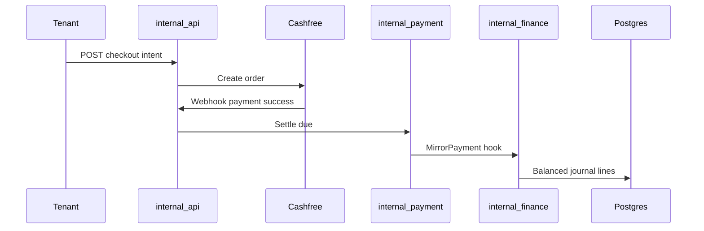

# pg-go system architecture

**Style:** Modular monolith — one HTTP server, many job binaries, one Postgres database.

**Scale envelope:** 1–10 properties, 50–500 tenants, 5–20 staff (see [TEST_READINESS_SPECIFICATION](wayfinder/TEST_READINESS_SPECIFICATION.md)).

## Context

pg-go tracks rent dues for PG/hostel operators. Tenants pay via UPI (Cashfree) or cash. The service matches bank notes (`PG-XXXXXX`) to dues. Finance modules mirror payments into a double-entry ledger.

**Primary UI:** [pg-react](https://github.com/pg-cashflow/pg-react) (external). **Fallback UI:** frozen shell at `/app/` in dev (see [web/README.md](../web/README.md)).

## Containers

| Container | Path | Role |
| --- | --- | --- |
| HTTP API | `cmd/server` | Gin REST, webhooks, embedded SPA catch-all |
| Migrations | `cmd/migrate` | Apply `migrations/*.sql` |
| Jobs | `cmd/billing-cycle`, `cmd/reminder`, … | Scheduled work (ADR-030 worker role) |
| Database | Neon / Postgres | RLS, triggers, ledger invariants |
| Cashfree | External | Checkout, payouts, settlements, KYC |
| Firebase | External | Phone / Google auth |
| SMS / SMTP | `internal/sms`, `internal/mailer` | OTP, reminders, alerts |

## First-principles invariants

| Invariant | Where to enforce / debug |
| --- | --- |
| Integer paise only | `internal/domain`, `internal/finance`, `internal/payment` |
| Balanced journals | `internal/finance`, `migrations` ledger triggers |
| Property scope (RLS) | `internal/postgres` ScopedDB, `internal/auth`, `internal/requestscope` |
| Fail-closed security | Webhooks, metrics, KYC, `internal/config/validate.go` |
| Idempotent webhooks and jobs | `handlers_pay_webhooks.go`, outbox tables, `internal/jobs` |
| Correctness over latency | Keep monolith boundaries clear; avoid premature splits |
| Dual DB pools | ADR-020, ADR-030 — see pool topology below |

**Composition root:** [`internal/app/bootstrap.go`](../internal/app/bootstrap.go) wires repos and services for `cmd/server`.

## Module map (M1–M12)

| Module | Topic | Primary packages |
| --- | --- | --- |
| M1 | Identity / auth | `internal/auth`, `handlers_auth` patterns in `internal/api` |
| M1b | Manager delegation | `internal/postgres` capability repo, ADR-032 |
| M2 | Tenancy | `internal/tenant`, `internal/join` |
| M3 | KYC | `internal/kyc`, `internal/aadhaar` |
| M4 | Rent collection | `internal/billing`, `internal/payment`, `internal/collector` |
| M5 | Gateway | `internal/cashfree`, pay webhooks |
| M6 | Ledger | `internal/finance`, `finance_repo*.go` |
| M7 | Money out | Payout handlers, `internal/finance` payout dispatcher |
| M8 | Insights | `internal/intelligence`, `internal/roi` |
| M9 | Engagement | `internal/gamification` |
| M10 | Property ops | `internal/propertyops` (boundary), gamification handlers |
| M11 | Comms | `internal/notification`, `internal/push`, `internal/sms` |
| M12 | Platform | `internal/config`, `internal/app`, `cmd/*`, search |

See [modules/](modules/) for journeys per module.

## Critical flows

### Rent due → payment → ledger

### Payout maker-checker (summary)

Owner creates batch → draft state → separate approver (or step-up OTP for solo owner) → export only when approved → optional Cashfree dispatch.

### Departure settlement + outbox

`SettleDeparture` commits business state → enqueues `ledger_outbox_events` → worker mirrors ledger with retry and dead-letter alerts.

## Database pool topology

| URL env | Role (production) | Used by |
| --- | --- | --- |
| `DATABASE_URL` | `pgapp_app` | Scoped tenant/owner reads and writes |
| `DATABASE_MAINT_URL` | `pgapp_maint` | Admin repos, search pool fallback, some writers |
| `DATABASE_WORKER_URL` | `pgapp_worker` | `cmd/*` job binaries (ADR-030) |
| `DATABASE_URL_UNPOOLED` | Direct | `cmd/migrate` only |

`cmd/server` validates roles at startup via `postgres.ValidateStartupRoles`.

## Extension rules

1. Put business logic in `internal/{domain-service}`, not in handlers.
2. Put SQL in `internal/postgres` repos; keep `internal/domain` free of SQL.
3. Add HTTP routes in `internal/api` and register in `router_*.go` files.
4. Record cross-cutting decisions in `docs/adr/`.
5. Add journeys to the matching `docs/modules/M*.md` file.
